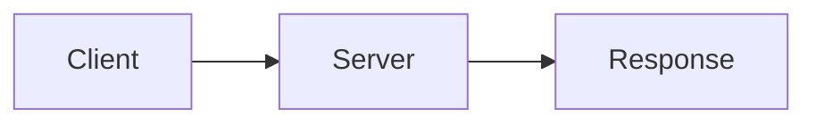

# Introduction

HTTP uses a request-response protocol.[^c1]

```kit:callout
variant: tip
title: Status code shape
body: HTTP status codes contain three digits.
```



```ts
const successfulStatus: number = 200;
```

[^c1]: [HTTP overview](https://developer.mozilla.org/en-US/docs/Web/HTTP)